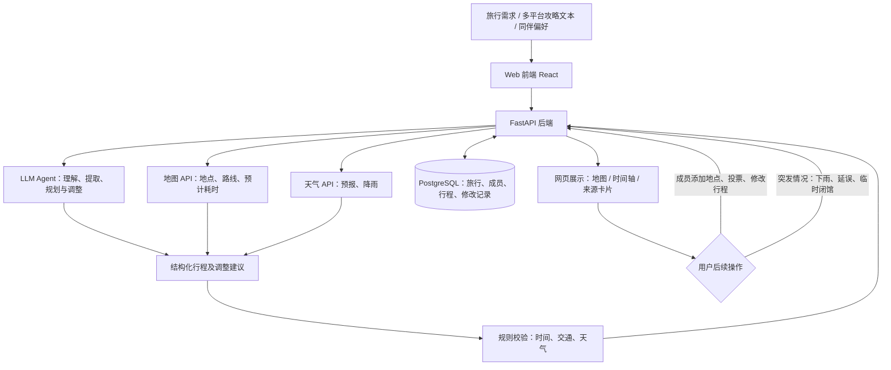

# Travel Agent Proposal — 技术方案、技术栈、数据源与风险

> 用于开题汇报。目标是实现**可规划、可编辑、可协作、能应对变化**的网页旅行助手；第一版优先完成可验证的业务闭环。

---

## 1. 技术方案

用户输入旅行需求、粘贴不同平台的攻略内容，或与同行成员共同编辑旅行计划。系统利用 LLM 解析需求和攻略，结合地图、天气等外部数据生成可调整的行程，并在时间轴与地图上统一展示；遇到突发情况时，用户可主动报告，系统检查影响并提供备选调整方案。

**第一版交互范围：**支持攻略文本导入与来源标注、结构化行程、地图/时间轴、天气、基础路线优化、多人共享行程与异步编辑、用户主动报告突发情况后获得调整建议。实时共同拖拽、自动监测各平台动态和自动执行预订暂不纳入。

---

## 2. 技术栈

| 模块 | 推荐技术 | 作用 |
|---|---|---|
| 网页前端 | React + TypeScript | 旅行创建、地图与时间轴、攻略来源卡片、多人协作界面 |
| 交互与设计对接 | Figma + 前端组件 | 将 UI、地点卡片、投票和编辑状态落地到网页 |
| 后端 | Python + FastAPI + Pydantic | 接口调度、数据验证、权限检查、调用 Agent 与第三方 API |
| 数据库 | PostgreSQL + SQLAlchemy | 保存用户、旅行成员、偏好、行程、投票及修改记录 |
| AI | LLM API + 结构化 JSON 输出 / 工具调用 | 解析攻略、整合偏好、生成计划、解释和处理突发情况 |
| 地图 | 高德地图 JS API + Web 服务 API（国内路线优先） | POI 搜索、位置标记、路程与时间估算、路线展示 |
| 天气 | 天气服务 API（如和风天气 / OpenWeather，按覆盖范围选型） | 行前预报、降雨信息、突发天气时的调整依据 |
| 多平台内容 | 文本解析 + 统一内容模型 | 把来自不同平台的攻略整理成带有来源信息的地点卡片 |
| 用户与权限 | 登录认证 + Trip 成员角色校验 | 控制谁可以查看、编辑、投票、删除 |

**实现取舍：**第一版采用**多人异步协作**（保存后其他成员刷新即可见），因此暂不需要 WebSocket；同时用数据库版本号或更新时间避免覆盖他人的修改。可以由一个后端负责常规业务，Agent 作为后端模块调用，不必直接引入多 Agent 或 MCP。

---

## 3. 数据源

| 数据类别 | 来源 | 用途 |
|---|---|---|
| 用户旅行需求 | 用户输入的目的地、日期、预算、偏好、出行节奏 | 个性化规划的基础条件 |
| 多平台攻略 | 用户粘贴的小红书、携程、博客等攻略**文本**及原始来源链接 | 提取景点、餐厅、酒店、建议停留时间，并生成统一来源卡片 |
| 多人协作数据 | 同行成员填写的偏好、候选地点、投票、行程编辑记录 | 协调多人需求、记录决策与修改历史 |
| 地图与地点 | 地图服务 API 的地点、坐标、路线及预计耗时 | 地图展示、路线优化、交通时间校验 |
| 天气 | 天气 API 提供的预报、温度、降雨等 | 天气感知规划与异常情况处理 |
| 旅途突发事件 | 用户主动输入“下雨了”“航班延误”“景点关闭”等；可用 API 补充验证 | 找出受影响行程并生成可解释的替代方案 |
| 行程业务数据 | 系统自身 PostgreSQL 数据库 | 保存旅行、成员权限、地点、日程、来源、投票和变更记录 |

**数据边界：**第一版不自动抓取微信、QQ、小红书或携程的私人内容，也不承诺第三方平台链接一定能够直接解析全文；链接主要保存为来源，正文优先由用户粘贴提供。航班延误、临时闭馆等事件在缺乏可靠接口时以用户报告为准，并标记“待核实”；景点开放时间也须以可获取的官方信息或可核验数据为依据。超出天气 API 预报覆盖期的旅行日期，不展示虚构的天气预测。

---

## 4. 技术风险与应对

| 主要风险 | 应对措施 |
|---|---|
| LLM 生成不存在的地点或不合理路线 | 利用地图 API 验证地点、路线与预计耗时；无法核实的数据显式标注 |
| 外部数据不全或 API 有额度限制 | 查询结果缓存、错误提示、人工输入兜底；优先使用可获得的正式接口 |
| 天气预报变化、突发事件难以实时核验 | 标明数据时间和来源；第一版由用户主动报告，调整前展示建议供确认 |
| 多人同时修改导致数据覆盖 | 后端执行权限校验，使用版本号/更新时间检测冲突，保留修改记录 |
| 多平台链接无法解析、来源信息丢失 | 第一版统一从粘贴文本提取，同时保存来源平台与原始链接，不依赖抓取 |
| Agent 输出不稳定、误改行程 | 使用结构化 JSON 与后端规则校验，修改前展示差异，由用户确认后保存 |
| 功能过多导致无法完成 | 优先完成“导入文本 → 规划 → 地图展示 → 多人异步编辑 → 事件触发调整”主流程；OCR、实时协同和自动事件监测后置 |
