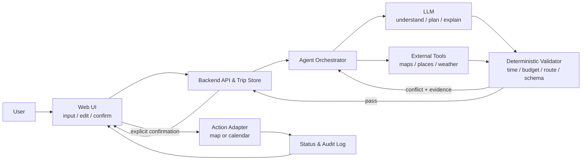

# AI 旅行助手 Proposal：系统设计与工作计划材料

# 1. AI 的作用（Role of AI）

## 1.1 一句话定位

**AI is used for understanding, planning, and explanation; deterministic services are used for facts, calculations, validation, storage, and external actions.**

中文解释：AI 负责理解用户意图、生成候选方案和解释修改；地图/天气等工具负责提供事实，规则与代码负责计算和校验，用户负责最终确认。

## 1.2 AI 与确定性模块的职责边界

| 环节 | AI 负责 | 非 AI 模块负责 | 这样划分的原因 |
|---|---|---|---|
| 需求理解 | 从自然语言中提取日期、出发地、预算、人数、兴趣、步行偏好等；缺信息时追问 | 类型、范围、必填项校验 | 自然语言有歧义，但字段合法性可以用代码确定 |
| 攻略理解（候选增强） | 从用户粘贴的文本中提取地点、餐厅、建议时长和标签 | 文本长度限制、恶意内容隔离、地点实体核验 | AI 擅长抽取；外部文本不能被当作系统指令 |
| 行程生成 | 根据结构化约束形成候选日程，给出安排理由 | 时间运算、预算求和、路线时长、营业时间检查 | 模型可以提出方案，但不应自行断言实时事实 |
| 交互修改 | 理解“少走路”“把博物馆换到第二天”等修改，解释前后差异 | 保留版本、计算差异、重新运行规则检查 | AI 负责语义与解释，代码保证结果一致性 |
| 路线优化 | 在多个可行方案之间给出偏好理由 | 地图路线矩阵、排序算法、硬约束校验 | 路线距离和时长应以工具结果为准 |
| 外部动作 | 把确认后的计划转为地图/日历所需参数 | 预览、权限检查、幂等控制、真正调用 API、返回成功/失败状态 | 防止 AI 未经确认执行错误或重复动作 |

## 1.3 PPT 可直接使用的英文文案

**Role of AI**

- Understand natural-language travel needs and convert them into structured constraints.
- Generate a candidate itinerary and explain why each item is included.
- Revise the itinerary when a user changes a preference and summarize the differences.
- AI does not act as the source of truth: maps, weather, calculations, and rule checks verify the plan.
- External actions require an explicit user preview and confirmation.

---

# 2. 推荐架构与完整工作流

## 2.1 架构图（ PPT 同学可以重绘）



## 2.2 图中必须强调的四个控制点

1. **Source grounding**：外部事实带来源和查询时间；估算值明确标记为 estimate。
2. **Deterministic validation**：预算、时间重叠、路线时长、字段格式等不用 LLM 自我判断。
3. **Human confirmation**：地图/日历动作前展示预览，并由用户确认。
4. **Failure recovery**：API 超时、无结果或模型输出非法时，保留用户输入，显示可恢复错误，不伪造成功。

## 2.3 PPT 可直接使用的英文图注

**The LLM proposes; tools provide current facts; deterministic checks validate; the user confirms; the system records the result.**

---

# 3. 主要风险、缓解方案与验证计划

## 3.1 PPT 主表：六个优先风险

| ID | Main risk | Mitigation | Planned verification / pass criterion |
|---|---|---|---|
| R1 | Hallucinated or stale travel facts | Ground factual fields in tools; show source and query time; label estimates; never let the model invent missing values | 20 representative plans; at least 95% of factual fields traceable to a source; 0 invented opening hours or quoted prices in the test set |
| R2 | The itinerary violates time, budget, route, or user constraints | Convert requests to structured constraints; validate by code; return conflicts to a repair loop; keep hard and soft constraints separate | Boundary and conflict tests; 100% detection of defined hard-constraint violations; at least 90% overall conflict-detection recall on the pilot set |
| R3 | External APIs are slow, unavailable, rate-limited, or return no result | Timeout, retry with backoff, cache where permitted, quota/cost alerts, and a clear degraded mode | Inject timeout, 429, empty-result, and invalid-key failures; 0 crashes; 100% of injected failures show a recoverable status and do not claim success |
| R4 | An incorrect or duplicate external action is executed | Preview + explicit confirmation; least privilege; allowlisted actions; idempotency key; action log; cancel/retry states | 20 action tests; 0 writes before confirmation; 0 duplicate calendar events after repeated clicks/retries; every action has a final status |
| R5 | Prompt injection or unsafe model output from imported guides/web content | Treat external text as untrusted data; separate instructions from content; schema validation; sanitize outputs; validate every tool parameter | Red-team with at least 10 injection/unsafe-output cases; 0 unauthorized tool calls, secret exposure, or executable model output |
| R6 | Scope and integration risk across six members | Freeze the core workflow and shared data contract first; use mock data; integrate one vertical slice early; keep extensions behind priorities | A vertical-slice acceptance test runs end-to-end before optional features; API/schema contract tests pass; each module has an owner and handoff artifact |

> 说明：表中的数字是 Proposal 阶段的“初始验收目标”，不是已经取得的结果。正式开发后应根据试点难度和用户研究结果校准，但任何涉及未经确认的外部动作、泄露密钥或伪造成功的指标仍应保持为 0。

## 3.2 完整风险登记表（答辩与附录用）

### R1. 模型幻觉与信息过期

**风险表现**

- 模型生成不存在的景点、错误地址、错误营业时间或看似精确的价格；
- 将历史信息当成当前信息；
- 用户因自动化偏见而过度相信“看起来完整”的行程。

**缓解方案**

- 把地点 ID、地址、营业时间、路线时长、天气、票价等标为“必须由工具提供或人工输入”的字段；
- 每条易变化事实保留 `source`、`queried_at`、`value_type = quoted | estimated`；
- 无来源时显示“未核实”，不让模型补值；
- UI 显示冲突、不确定性和数据时间；
- 对事实字段做二次校验，必要时要求用户确认。

**验证方法**

- 建立 20 个代表性旅行任务，人工制作事实基准；
- 统计事实可追溯率、错误事实数、过期信息提示率；
- 对 API 返回空值、旧时间戳、互相冲突的来源做异常测试。

**初始通过标准**

- ≥95% 的事实字段可追溯到工具结果或明确的用户输入；
- 测试集中“凭空生成的营业时间/已报价价格”为 0；
- 所有估算价格都有 estimate 标签。

### R2. 行程违反用户约束或现实约束

**风险表现**

- 超预算、活动时间重叠、闭馆后到达；
- 交通时间不足；
- 用户要求少步行，但方案安排了长距离步行；
- 修改一个约束后，旧约束残留或产生新冲突。

**缓解方案**

- 将日期、预算、人数、步行上限等转换为结构化约束；
- 区分 hard constraints（不可违反）和 soft preferences（用于排序）；
- 使用代码计算预算、时间间隔和路线时长；
- 模型输出后运行 validator，冲突信息返回给规划器修复；
- 仍无法满足时，明确告诉用户哪条约束不可同时满足。

**验证方法**

- 单元测试：时间重叠、跨日、零/负预算、缺失地点、营业时间边界；
- 属性/组合测试：随机生成多组日期、预算和活动数量；
- 端到端测试：修改预算、出发时间或步行偏好后重新规划；
- 人工评审软偏好是否得到合理体现。

**初始通过标准**

- 已定义的 hard-constraint 违规检测率 100%；
- 试点集总体冲突检测召回率 ≥90%；
- 无法满足时不输出“已满足全部条件”。

### R3. 地图、天气或其他外部服务失败

**风险表现**

- 超时、429 限流、配额耗尽、认证失败、无搜索结果；
- API 成本失控；
- 某地区或交通方式不受支持；
- 不同时间查询得到不同路线，测试结果不稳定。

**缓解方案**

- 为每次请求设置超时；仅对可重试错误做有限次数重试和指数退避；
- 在许可范围内缓存稳定结果，记录查询时间；
- 设日配额、成本告警和调用日志；
- 提供 degraded mode：保留草案，但明确“未完成路线/天气核验”；
- 自动化测试用 mock 响应，少量端到端测试调用真实服务。

**验证方法与通过标准**

- 注入 timeout、429、401/403、空结果、字段缺失；
- 0 崩溃，0 伪造成功；
- 100% 注入失败显示具体且可恢复的状态；
- 失败后用户输入与已有行程不丢失；
- 记录每次外部调用的类型、耗时、状态和成本估算。

### R4. 外部动作错误、重复或越权

**风险表现**

- 错日期、错时区、错地点被写入日历；
- 用户双击或重试造成重复事件；
- 模型在用户确认前执行动作；
- 工具权限过大，导致超出本项目范围的操作。

**缓解方案**

- 采用 plan → preview → explicit confirm → execute → verify 的动作状态机；
- 外部动作只接受经过 schema 和权限校验的参数；
- 限定可用工具和最小权限；
- 使用 idempotency key 或本地去重记录；
- 写入后读取/检查结果，并显示 success / failure / pending；
- 对删除和覆盖操作要求更强的二次确认。

**验证方法与通过标准**

- 20 个动作场景覆盖取消、重复点击、网络重试、错误时区和权限拒绝；
- 用户确认前外部写入为 0；
- 重复点击/重试产生的重复事件为 0；
- 每次动作都有可追踪的最终状态。

### R5. 提示词注入与不安全输出

**风险表现**

- 攻略文本或网页内容包含“忽略之前指令”等恶意内容；
- 模型把不可信文本转换为工具调用；
- 模型输出未经处理直接进入 HTML、数据库或外部 API。

**缓解方案**

- 把用户/网页内容作为 data，而不是高优先级 instruction；
- 导入文本与系统指令分区，限制长度和允许提取的字段；
- 所有模型输出先做 JSON Schema、枚举、长度、URL 和坐标校验；
- 外部工具采用 allowlist 和最小权限；
- 前端做上下文相关编码，后端使用参数化查询；
- 不在提示词中放 API key、访问令牌或敏感数据。

**验证方法与通过标准**

- 至少 10 个红队样本：忽略指令、诱导泄露密钥、任意 URL、脚本/SQL、伪造工具结果；
- 未授权工具调用、敏感信息泄露、可执行模型输出均为 0；
- 所有拒绝或清洗行为有日志可复现。

### R6. 隐私、密钥和日志泄露

**风险表现**

- 行程可能暴露日期、位置、住宿等敏感信息；
- API key 被放入前端或提交到 Git；
- Prompt/错误日志保存了不必要的个人信息。

**缓解方案**

- 数据最小化：只收集当前流程必需字段；
- API key 仅保存在服务端环境变量，按 API/来源限制权限；
- 日志脱敏，不记录完整令牌或不必要的旅行细节；
- 为样例演示使用合成或去标识数据；
- 明确保存、删除和导出的行为。

**验证方法与通过标准**

- 仓库 secret scan 与前端构建产物检查；
- 日志抽查；未授权读取/修改测试；
- Git 和前端包中有效密钥为 0；
- 日志中完整令牌为 0；
- 删除旅行后，系统不再从普通接口返回该行程。

---

# 4. 验证计划（Verification Plan）

## 4.1 测试金字塔

| 层级 | 验证内容 | 示例 | 主要指标 |
|---|---|---|---|
| Unit tests | 确定性规则与数据处理 | 时间重叠、预算求和、日期/时区、schema 校验 | pass rate；边界覆盖 |
| Contract tests | 前端—后端—Agent 的接口一致性 | 请求/响应字段、错误码、版本兼容 | schema-valid rate = 100% for service contracts |
| AI eval set | 模型理解、生成和修改行为 | 缺信息追问、约束提取、改变预算后重规划 | constraint extraction F1；hard-constraint pass rate；human rating |
| Integration tests | 真实模块连接 | 地图/天气查询、保存读取、模型+validator repair loop | success rate；latency；failure recovery |
| End-to-end tests | 完整用户任务 | 输入→生成→修改→确认→地图/日历动作 | task completion rate；no unauthorized action |
| Usability tests | 用户是否看得懂、改得动、敢确认 | 任务观察 + 简短访谈 | completion time；error rate；SUS/简化评分；主要困惑点 |
| Red-team / failure tests | 安全和异常 | prompt injection、429、空结果、重复点击 | unauthorized actions = 0；false success = 0 |

## 4.2 建议的最小评测集

至少准备 20 个固定任务，覆盖：

- 5 个正常任务：不同天数、预算、兴趣；
- 5 个约束冲突任务：预算过低、活动重叠、营业时间不可能、交通不足、步行要求冲突；
- 3 个缺信息任务：缺日期、缺出发地、偏好模糊；
- 3 个修改任务：改预算、改出发时间、改为少步行；
- 2 个外部服务失败任务：超时、无结果/限流；
- 2 个安全任务：恶意攻略文本、重复确认/重复点击。

每条样本保存：输入、预期结构、必须满足的硬约束、允许变化的软偏好、外部工具 fixture、实际输出、失败原因、模型/Prompt/Schema 版本。

## 4.3 核心量化指标

1. **Constraint extraction accuracy**：用户明确表达的约束被正确提取的比例。
2. **Hard-constraint satisfaction rate**：最终行程满足硬约束的比例。
3. **Conflict-detection recall**：测试集中已知冲突被发现的比例。
4. **Source traceability**：易变化事实能追溯到来源及查询时间的比例。
5. **Schema-valid rate**：Agent 输出通过结构校验的比例。
6. **Task completion rate**：用户能否完成生成、修改、确认和动作执行。
7. **Unsafe-action rate**：未确认/越权/重复外部动作比例，目标为 0。
8. **Failure transparency**：失败时是否显示真实状态，而非伪造成功，目标为 100%。
9. **Latency and cost**：p50/p95 响应时间、每次生成的 Token 与成本；先测基线，再定阈值。

## 4.4 一条可在最终展示中复用的验收场景

```text
Given:
  用户从广州出发，旅行 2 天，预算 1500 元，希望少走路。

When:
  系统生成行程；用户将预算改为 1200 元；
  系统解释删改内容并重新检查时间、预算和路线；
  用户确认后选择“打开地图路线”或“创建日历事件”。

Then:
  行程结构完整；硬约束无冲突；事实带来源/时间；
  修改前后差异可见；外部动作只在确认后执行；
  最终状态显示成功或具体失败原因。
```

---

# 5. 团队分工

## 5.1 Proposal 阶段的六人分工

按当前分配，不填写姓名时可在 PPT 中先用角色代称：

| 成员 | Proposal 责任 | 交付物 |
|---|---|---|
| Technical A + Design A | 合作制作与整合 PPT | 英文叙事、统一版式、架构/流程图、引用、排练稿、最终 PDF |
| Technical B | 技术栈与数据源 | 技术栈选择、外部数据/API、成本/配额与可行性依据 |
| Technical C | AI 的作用；主要风险、缓解方案与验证计划 | AI/规则边界、风险主表、测试矩阵、验收指标、答辩备份页 |
| Design B | 用户故事与主业务流程 | 2–3 条用户故事、1 条完整主流程、关键交互节点 |
| Design C | 现实背景与竞品分析 | 目标用户背景、痛点证据、相关工作、竞品差距 |

全员都要能解释完整系统，而不仅是自己的页。

## 5.2 开发阶段的长期角色映射

暂时与《分工与计划_v4》保持一致：

- 技术 1：Web 前端与地图/时间轴/编辑交互；
- 技术 2：后端、数据库、地图/天气接口与数据校验；
- 技术 3：LLM、Prompt、结构化输出、规划/解析、冲突检测与 Agent 评测；
- 设计 1：核心页面 UI；
- 设计 2：编辑、拖拽、错误/确认/空状态等交互；
- 设计 3：视觉规范、组件库、地图 Marker 和天气样式。

---

# 6. PPT 页面建议

如果 Proposal 的页数紧张，第二部分可以压成 3 页：

### Slide A — System design and the role of AI

- 左侧：架构图；
- 右侧：AI / deterministic tools / user confirmation 三层职责；
- 底部一句话：The LLM proposes; tools provide facts; rules validate; the user confirms.

### Slide B — Main risks, mitigation, and verification

- 放 R1–R6 主表；
- 每行只保留 risk / mitigation / test；
- 用颜色标出两个“必须为 0”的指标：unauthorized actions、false success。

### Slide C — Team plan and work plan

- 上半：六人 Proposal 分工；
- 下半：Scope & contract → parallel prototypes → vertical slice → revision/action → verification → extensions；
- 角落注明：Baseline fixed; priorities refined after user research.

详细风险 R1–R8、评测集和指标放到 backup slides，供 Q&A 使用。

---

# 9. PPT 英文精简版

## Slide: System design and the role of AI

**AI responsibilities**

- Convert natural-language needs into structured travel constraints.
- Generate and explain a candidate itinerary.
- Revise the plan when the user changes a preference.

**System safeguards**

- Current facts come from external tools with sources and query times.
- Code checks time, budget, route, and output schema.
- The user previews and confirms every external action.

**Key message**

> The LLM proposes; tools provide facts; deterministic checks validate; the user confirms.

## Slide: Risks and planned verification

- **Hallucinated or stale facts** → source grounding and timestamps → traceability test.
- **Constraint violations** → structured constraints and rule checks → conflict and boundary tests.
- **API failure or rate limits** → timeout, retry, quota control, degraded mode → fault injection.
- **Incorrect external actions** → preview, confirmation, least privilege, idempotency → zero unconfirmed or duplicate writes.
- **Prompt injection / unsafe output** → treat imported content as untrusted data; schema and parameter validation → red-team tests.
- **Scope and integration risk** → fixed baseline, shared contracts, mock data, early vertical slice → end-to-end acceptance test.

## Slide: Team and work plan

**Proposal roles**

- Two members: slide integration, English narrative, diagrams, and rehearsal.
- One technical member: technology stack and data sources.
- One technical member: AI role, risks, mitigation, and verification.
- One design member: user stories and the main workflow.
- One design member: background and competitor analysis.

**Work plan**

> Scope & contract → parallel prototypes → first vertical slice → interactive revision and action → verification and user pilot → optional extensions.